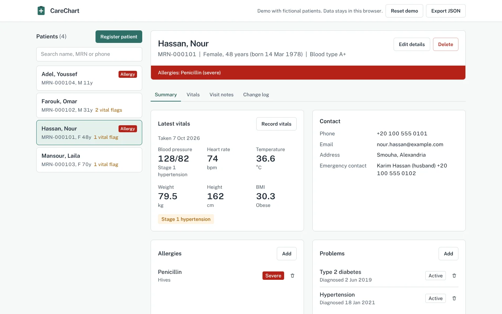

# CareChart EHR

An electronic health record (EHR) web app for a small clinic: register patients, keep their allergies, problems and medications up to date, record vitals, follow blood-pressure trends, and write visit notes in the SOAP format clinicians use.

**Live demo:** [ADD: Vercel URL] — loads four fictional patients. Everything you change stays in your own browser.



## What it does

- **Patient register** with search by name, medical record number (MRN) or phone. Each new patient gets the next MRN automatically.
- **Patient banner** that puts identity first and allergies where they can't be missed: a red band for severe allergies, a tint for the rest.
- **Problems and medications** that can be marked active or inactive, so history is kept instead of deleted.
- **Vitals** with automatic BMI, a blood-pressure category using the ACC/AHA adult thresholds, and flags for fever, abnormal heart rate and hypertensive crisis.
- **Blood-pressure trend chart**, drawn as hand-written SVG, against the 130/80 line where stage 1 hypertension starts.
- **SOAP visit notes**: Subjective, Objective, Assessment, Plan.
- **Change log**: every edit to a record is written to an audit trail with a timestamp.
- **Validation everywhere**: each form is checked against one shared schema (Zod). A date of birth in the future, a phone number with letters, or a diastolic reading above the systolic is rejected with a message on the field that's wrong.
- **Export** the whole database as JSON, or reset to the demo patients.
- Works on phones, uses visible keyboard focus, and respects reduced-motion settings.

## Tech stack

Next.js (App Router) · React · TypeScript · Tailwind CSS · Zod · Vitest · Vercel

## How it's built

```
src/lib/schema.ts     Data model and validation rules (Zod)
src/lib/store.ts      PatientStore: every read and write, validation, audit trail
src/lib/clinical.ts   Age, BMI, blood-pressure categories and vital flags
src/lib/seed.ts       The fictional demo patients
src/components/       Patient list, chart tabs, forms and the SVG trend chart
```

All data access goes through `PatientStore`, which takes a storage interface instead of using `localStorage` directly. The UI never touches storage itself. That keeps the clinical rules testable on their own, and means a server-backed version only needs a new storage adapter, not a new app.

The demo keeps records in the browser's `localStorage` on purpose: it can be shared publicly without a database, and no visitor's data reaches a server. A real deployment would put the store behind an authenticated API with role-based access and encryption at rest.

## Run it locally

```bash
npm install
npm run dev     # http://localhost:3000
npm test        # 25 unit tests for the clinical rules and the store
npm run build
```

## Disclaimer

A portfolio project, not a medical device. All patients and clinicians in the demo are fictional.

## Author

**Mayar Mohamed Issa** · [GitHub](https://github.com/MayarIssa) · [LinkedIn](https://www.linkedin.com/in/mayar-issa/)
